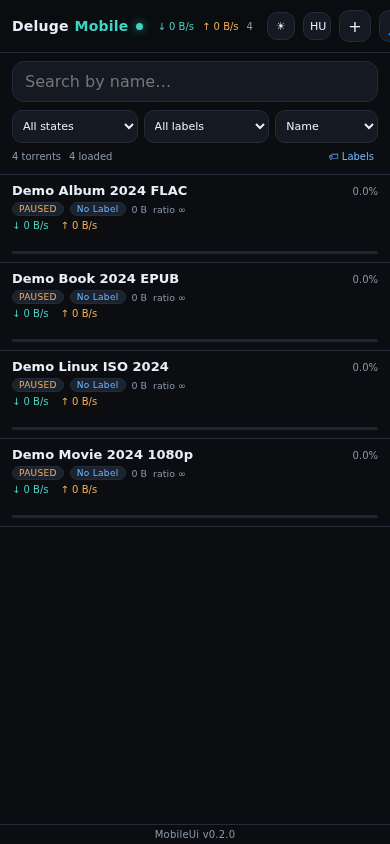
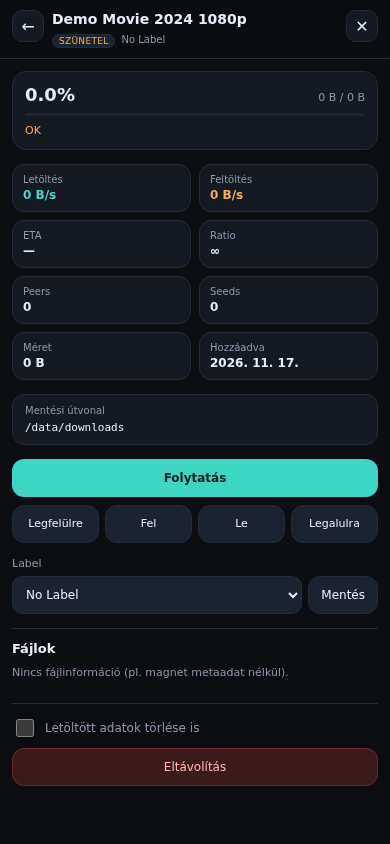
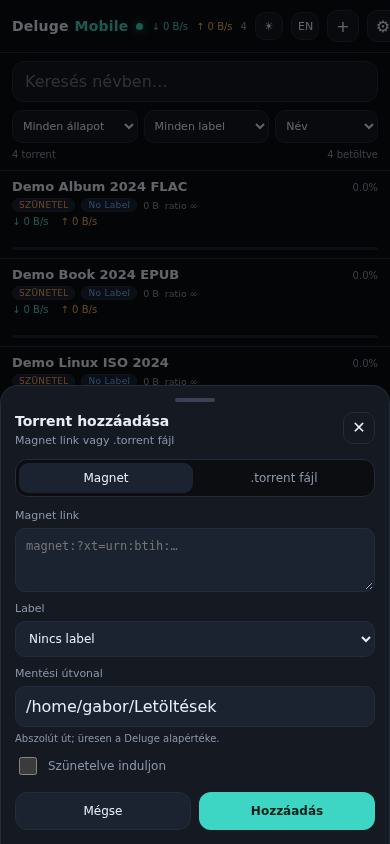
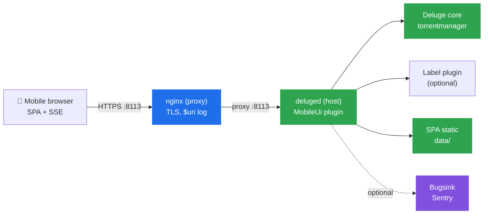

# Deluge MobileUi

A mobile-first web UI for Deluge, running **as a core plugin inside `deluged`**.
Its own HTTP API/SPA listens on port **8113**; the stock `deluge-web` stays on
8112. Deluge **2.x** (Python 3.10+), tested in production with **2.2.0**; CI
also runs the backend suite against real Deluge 2.0.3 / 2.1.1 / 2.2.0. Deluge
1.x is not supported.

[](https://github.com/gabordeli/mobileui/releases)
[](LICENSE)
[](https://www.python.org/)
[](https://deluge-torrent.org/)
[](https://nodejs.org/)
[](https://github.com/gabordeli/mobileui/actions/workflows/release.yml)
[](https://ko-fi.com/gabordeli)

## 📱 Screenshots

| List | Details | Add |
| --- | --- | --- |
|  |  |  |

Demo data from the local `scripts/dev-daemon.sh` (fictional names), dark theme.

## 📊 Status

Current release: **v1.1.0** (GitLab + GitHub), deployed on the production
instance.

- **Auth:** optional Deluge username/password login next to the static API token
  (`auth_mode`), expiring and revocable session tokens, with read-only (1) /
  normal (5) / admin (10) levels; the static token remains a break-glass path.
- **Torrent list:** paginated and filtered API, virtualized infinite scroll,
  search/filter controls, sort by name/progress/rate/ratio/ETA/size/added date,
  long-press selection, live SSE updates.
- **Torrent details:** compact primary stats (down/up/ETA) plus a muted
  ratio/peers/seeds/size/added line; collapsible tracker bar; per-file download
  checkboxes and "Only this"; speed limits and torrent options (sequential,
  ratio, connections); label, reannounce, force recheck and storage move.
- **Session sheet:** free space, torrent count, rates, 60-second speed
  sparkline, global pause/resume, global/torrent speed limits with a nightly
  preset, and the active-torrent queue settings.
- **Bulk selection:** long-press, bottom action bar for pause/resume/label/remove
  across N torrents, "All" using the filtered IDs (max 1000).
- **Add flow:** magnet, `.torrent` URL or `.torrent` file, label, absolute save
  path and "start paused"; remembers the last path/label; copy magnet/infohash
  from the detail.
- **PWA:** manifest/icons/service worker, Android share target, light/dark
  theme, HU/EN i18n, skeleton/offline/error states, safe-area and a11y basics.
  The SW caches the last read-only API responses and labels them as stale after
  an offline reload; logout clears that cache.
- **Labels & trackers:** create/delete labels from the filter bar; tracker list
  and force reannounce in the detail.
- **Errors:** red `Error` badge on the row based on state/message; `Error` state
  filter.
- **Web Push:** opt-in in the session sheet for finished/failed torrents; the
  notification opens the torrent detail (`/?torrent=<id>`). The text follows
  the browser language, **Test** sends one notification to the current device,
  and the Devices list can revoke a subscription. Requires HTTPS and the
  optional `pywebpush`; the VAPID key is generated automatically.
- **Torrent move:** actually moves the files via Deluge `move_storage`; the
  torrent enters `Moving` state and the UI follows it through SSE.
- **CI / SonarQube:** main-branch static analysis with backend/frontend
  coverage, Docker scanner and a blocking quality gate.
- **Bugsink:** backend `sentry-sdk` + frontend `@sentry/vue`, shared DSN; the
  backend `sentry_dsn` is configurable live.
- **GitHub mirror:** public `gabordeli/mobileui`, GitLab push mirror; GitHub
  Actions builds wheel/sdist/egg/sha256 assets with a CHANGELOG-based note. The
  GitLab repository stays private.

## 🧱 Architecture

```
deluge_mobileui/     Deluge core plugin (Twisted Site in the daemon reactor)
  core.py             enable()/disable(), config, auth, port bind
  auth.py             session tokens, login limit, bearer parser
  http.py             Twisted resources (/health, /api endpoints, 401/403)
  read.py             torrent/session/label reads (cached status)
  write.py            pause/resume/remove/label/queue/add/move
  push.py             VAPID key, subscription store, pywebpush delivery
  events.py           SSE broadcaster (EventManager + 1/s diff)
  data/               SPA build output (served statically by the plugin)
webui/                Vue 3 + Vite + TS SPA
  src/                App, API client, virtual list, sheets
scripts/dev-daemon.sh Local, disposable-config deluged
scripts/package.sh    Portable egg + sha256 (with the SPA)
scripts/publish_release.sh  GitLab Release + Generic Package upload
scripts/install.sh    Install/rebuild on the Deluge host (root)
tests/                pytest (mock core, real Twisted resources)
docs/                 install, API, operations and decisions
```

Public path (on the LAN the browser reaches the Deluge host's `:8113` directly):



## 🛠️ Development

```bash
python3 -m venv --system-site-packages .venv
.venv/bin/pip install pytest ruff build sentry-sdk

.venv/bin/pytest
.venv/bin/ruff check .
./scripts/package.sh   # dist/MobileUi-<version>-py3.x.egg + .sha256

# Local smoke: own config under .dev/, does not touch the user's Deluge
./scripts/dev-daemon.sh
curl -s http://127.0.0.1:8113/health
curl -s -H 'Authorization: Bearer dev-token' http://127.0.0.1:8113/api
```

On first start, `dev-daemon.sh` creates `.dev/deluge/core.conf`, adds `MobileUi`
to `enabled_plugins`, writes the `dev-token` token to `mobileui.conf`
(overridable with `MOBILEUI_TOKEN`), then starts the daemon.
`http://127.0.0.1:8113/` serves the SPA.

### SPA development

```bash
cd webui
npm ci
npm run build          # deluge_mobileui/data/
npm run test           # Vitest
npm run test:coverage  # webui/coverage/lcov.info
npm run test:e2e       # Playwright smoke (mocked API)
npm run dev            # proxy: 127.0.0.1:8113 (local deluged)
# for a deluged on another host:
VITE_API_PROXY=http://<deluge-host>:8113 npm run dev
```

The first `test:e2e` run needs `npx playwright install chromium`.

More details: [docs/webui.md](docs/webui.md).

## 📦 Installation

On the host, as root, from the repository checkout:

```bash
./scripts/install.sh
```

The script builds the egg, extracts it under `deluge.plugins`, restarts
`deluged`, enables the plugin and checks `/health`. The SPA is served at
`http://<host>:8113/`; the stock `deluge-web` stays on 8112.

Portable egg, config/RPC, the current installation and rollback:
[docs/install.md](docs/install.md).

## 📚 Documentation

- [docs/install.md](docs/install.md) – install, portable egg, config, rollback
- [docs/api.md](docs/api.md) – API schema
- [docs/perf.md](docs/perf.md) – measurement with 833 torrents and the chosen strategy
- [docs/webui.md](docs/webui.md) – SPA structure, pagination/virtualization, SSE
- [docs/usage.md](docs/usage.md) – mobile usage guide with gestures and screenshots
- [docs/ci.md](docs/ci.md) – CI stages, release and deploy
- [docs/decisions.md](docs/decisions.md) – decisions and constraints
- [docs/impact-post-1.0.md](docs/impact-post-1.0.md) – post-1.0 follow-up impact study
- [AGENTS.md](AGENTS.md) – working notes for agents

## 🤝 Contributing

The GitHub repository is a **one-way, read-only mirror** of the GitLab
development repository (public). Development happens on the private GitLab.
GitHub issues/PRs may be ported by the maintainer; see
[CONTRIBUTING.md](CONTRIBUTING.md).

## ☕ Support

If the project is useful, you can support development via
[Ko-fi](https://ko-fi.com/gabordeli).
