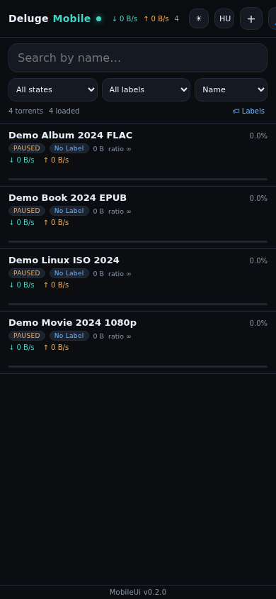
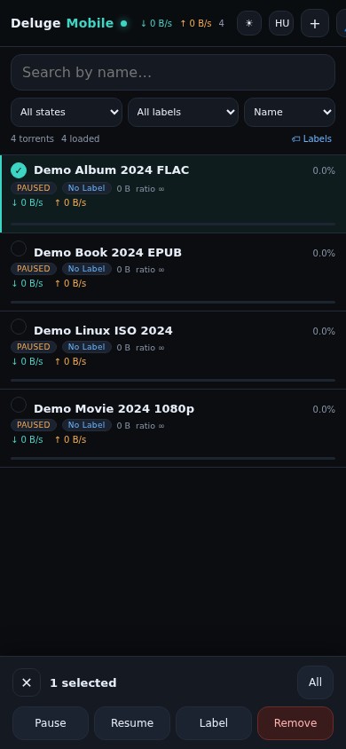
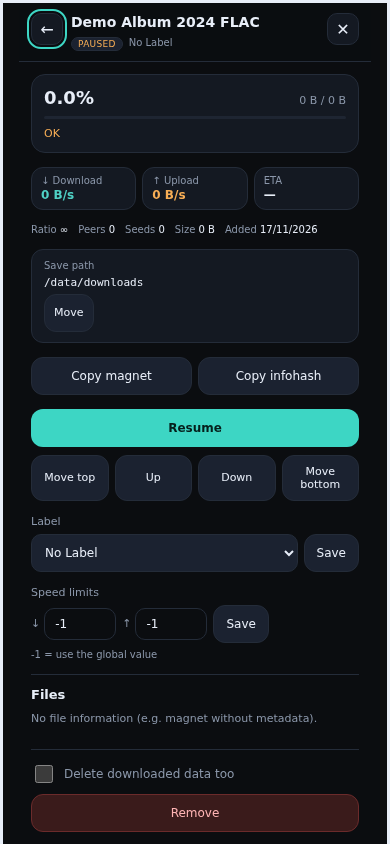
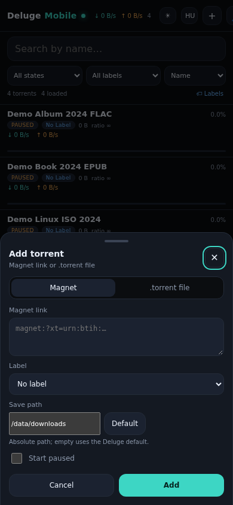
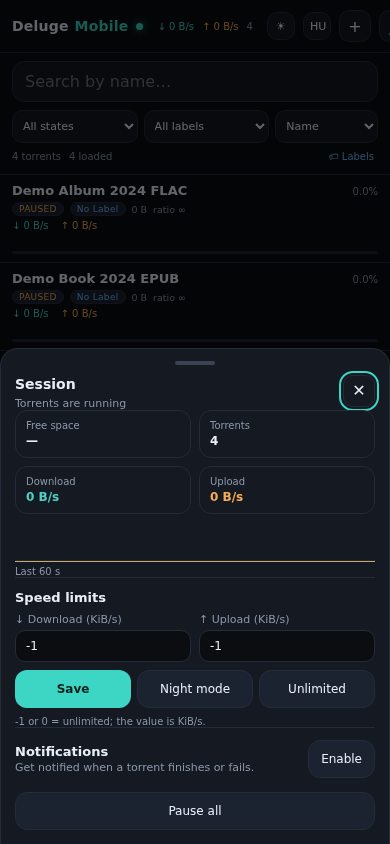
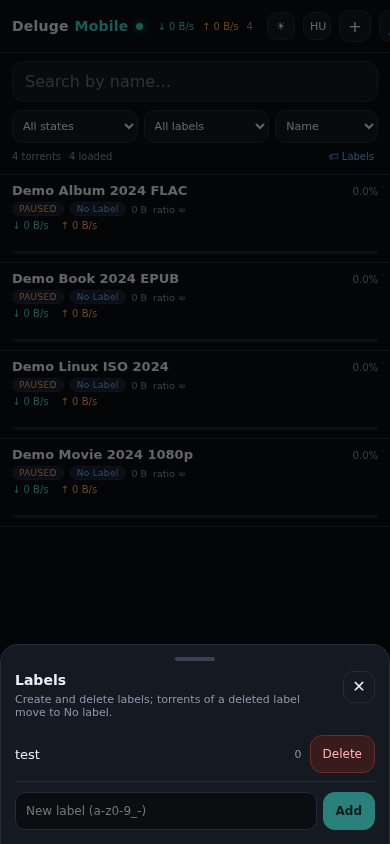

# Mobile usage guide

This guide is for everyday use on a phone. The same controls work with a mouse
on desktop. The screenshots use demo torrents from `scripts/dev-daemon.sh`.

## Open and sign in

Open `https://<deluge-host>:8113/` in the browser. The login screen depends on
the deployment:

- **Token:** paste the plugin/API token. The token is remembered in the
  browser's local storage.
- **Username/password:** use your Deluge account. The session expires after 30
  days and can be revoked from the account panel.
- **Both:** either method works.

On Android you can install the page as a PWA from the browser menu ("Add to
Home screen"). The installed app gets the share target and a standalone window.

## The torrent list

1. **Session stats** – tap the `↓ / ↑ / torrent count` button to open the
   session sheet (free space, rates, limits, notifications).
2. **Theme / language** – switch dark/light and HU/EN.
3. **Add torrent** – opens the add sheet.
4. **Account** – the person icon opens the account panel (login/logout), not
   the settings.
5. **Search** – filters by name; the list reloads after a short debounce.
6. **State / label / sort** – server-side filters; the chosen values stay in
   the URL/state while the page is open.
7. **Labels** – manage labels (see below).

The list is virtualized: scrolling loads the next page automatically. The
counter shows how many torrents are loaded and the total.

### Tap and long-press

- **Tap a torrent** – opens the details.
- **Long-press a torrent (about 0.5 s)** – enters selection mode. A tap after
  that selects/deselects rows.
- **Selection bar** – appears at the bottom: pause, resume, label, remove and
  "All" (select every torrent matching the current filters, max 1000).
- **Cancel** – the `✕` button leaves selection mode.

The long-press also works with the left mouse button on desktop. A normal click
is not treated as a long-press.

## Torrent details

The detail is intentionally compact:

- **Progress** – percentage, downloaded/total, state message.
- **Primary stats** – download, upload and ETA.
- **Secondary line** – ratio, peers, seeds, size, added date.
- **Tracker bar** – when the torrent has trackers, the bar shows the tracker
  host, status and count. Tap it to expand the full URL list; the reannounce
  button is next to it.
- **Save path** – the current download location. The **Move** button opens the
  move panel.
- **Copy magnet / Copy infohash** – copies to the clipboard.
- **Resume/Pause** – changes the torrent state.
- **Queue** – move to top, up, down or bottom of the queue.
- **Label** – choose a label and save.
- **Speed limits** – per-torrent KiB/s; `-1` uses the global value, `0` means
  unlimited.
- **Files** – when metadata is available, each file has a download checkbox
  and an "Only this" action. The search box filters the loaded pages.
- **Remove** – optionally deletes the downloaded data; a confirmation is
  required.

The detail updates live over SSE while it is open. Closing it returns to the
list without losing the filters.

### Move a torrent

Tap **Move** next to the save path, enter an absolute destination and confirm.

- The files are actually moved on disk by Deluge (`move_storage`), not just the
  save path.
- The torrent enters `Moving` state; the list/detail follows the state through
  SSE.
- The destination must be an absolute path and needs enough free space.
- A torrent that is already moving cannot be moved again.

## Add a torrent

- **Magnet / torrent file** – switch between the two tabs.
- **Label** – optional; "No label" leaves it unlabeled.
- **Save path** – absolute path. The **Default** button restores the session
  default. The last used path and label are remembered locally.
- **Start paused** – adds the torrent without starting it.

The sheet validates the input and shows the backend error message for an
invalid magnet, file or path.

## Session sheet

Open it from the header stats. It contains:

- free space, torrent count, current download/upload rates;
- a 60-second speed sparkline;
- global speed limits (KiB/s), with **Night mode** and **Unlimited** presets;
- **Notifications** – enable/disable Web Push for this browser;
- **Pause all / Resume all** – session-wide controls.

### Web Push

Push needs HTTPS (secure context) and a push-capable browser. Tap **Enable**,
allow notifications, and the browser subscribes. Notifications are sent when a
torrent finishes or enters the `Error` state. Tapping a notification opens the
torrent detail via `/?torrent=<id>`. The setting is per browser/device; the
server stores up to 20 subscriptions.

If notifications are blocked, the sheet explains how to allow them; on plain
HTTP the button reports that HTTPS is required.

## Labels

Open **Labels** from the filter bar. The sheet lists labels with torrent
counts, allows deleting a label (its torrents move to "No label") and creating
a new one. Label IDs are lowercase `a-z0-9_-`.

## Share from Android

With the installed PWA, use Android's share menu and choose **Deluge Mobile**.
A shared magnet link opens the add sheet with the link pre-filled. This works
from browsers and apps that support Android share targets.

## Errors and offline mode

- A red **Error** badge on a row means the torrent is in `Error` state; the
  tooltip/message contains the tracker or Deluge error.
- Use the **Error** state filter to show only failed torrents.
- When the connection drops, an offline banner appears and SSE reconnects
  automatically. The list/detail keep the last known values.
- A 401 response returns to the login screen; 403 means the account is
  read-only (mutating controls are hidden).

## Limits and tips

- Bulk operations work on at most 1000 torrent IDs.
- File lists are loaded in pages of 100 (max 500 per request); "More files"
  loads the next page.
- The detail is the place for per-torrent actions; the list is optimized for
  scanning and selection.
- The stock `deluge-web` on 8112 is untouched; this UI is independent.
